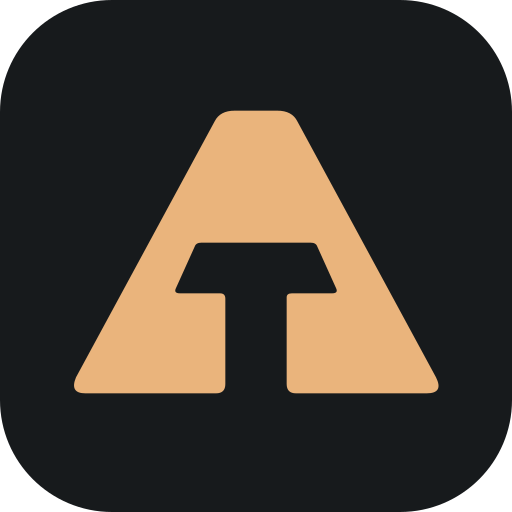

# Tiziano AI plugins

Specialist skills and tools for **Codex and Claude Code**. Add the
**`tiziano-ai`** marketplace once, then install only what you need.

## Choose a plugin

| Plugin | What you can do | Before you use it |
| --- | --- | --- |
| [Charter Skills](https://github.com/Tiziano-AI/charter-skills) | Apply specialist methods to product decisions, design, engineering, research and creative work. | Mac-first skill library; tools depend on the task. |
| [Deck Studio](https://github.com/Tiziano-AI/deck-studio) | Shape a story and build local HTML decks and screenshot PDFs. | Local Node.js, npm, Python and package-local Chromium setup. |
| [Voices](https://github.com/Tiziano-AI/voices) | Create reusable voices, audition speech and export the performance you selected. | Apple Silicon Mac, separate Voices CLI and local models. |
| [Walkthrough](https://github.com/Tiziano-AI/walkthrough) | Create a narrated film from real web-product use, then revise retained footage. | Apple Silicon Mac, separate Walkthrough CLI, Node 24, FFmpeg and local Voices with provisioned models and a saved narrator; applicable Remotion and model terms. |
| [Grokpair](https://github.com/Tiziano-AI/grokpair) | Delegate a bounded task to Grok Build while you keep working, then review its replies and files. | Grok Build CLI and your own authentication. |
| [Cloudflare Publish](https://github.com/Tiziano-AI/cloudflare-publish) | Give local HTTP(S) or pinned SSH services stable, protected hostnames. | Mac, separate CLI, cloudflared, and your own Cloudflare account and DNS zone. |
| [T3 Workers](https://github.com/Tiziano-AI/t3-workers) · alpha | Delegate tasks to visible workers in your T3 environment. | Running T3, configured providers and a native MCP connection. |

All seven support both hosts. Each repository explains setup, first use and
its limits. Installing a plugin does not install a separate application,
CLI or model, start work, publish anything, or grant provider access.

## Install

The example below installs Charter Skills. To choose another plugin, replace
`charter-skills` with `deck-studio`, `voices`, `walkthrough`,
`grokpair`, `cloudflare-publish` or `t3-workers`.

### Codex

```sh
codex plugin marketplace add Tiziano-AI/plugins
codex plugin add charter-skills@tiziano-ai
```

Use the CLI for your intended Codex installation; the desktop app's bundled
runtime can differ from `codex` on your PATH. In supported desktop clients,
you can also choose the plugin from the Plugins Directory after adding the
marketplace. Start a fresh local chat and check that its skills are available.

### Claude Code

```sh
claude plugin marketplace add Tiziano-AI/plugins
claude plugin install charter-skills@tiziano-ai --scope user
```

Run `/reload-plugins` where supported, or start a new session.

### Try Charter Skills

If you have an idea but are not sure how to turn it into useful work, invoke
Work Discovery and describe what you want to achieve:

- Codex: `$charter-skills:charter-work-discovery`
- Claude Code: `/charter-skills:charter-work-discovery`

For a clear task, ask for the work directly. The library supplies specialist
methods when they fit; it does not replace your standing instructions.

## Update

Refresh the marketplace, then update the plugin you selected. Substitute its
catalog name below if you installed something other than Charter Skills.

Codex:

```sh
codex plugin marketplace upgrade tiziano-ai
codex plugin add charter-skills@tiziano-ai
```

Claude Code:

```sh
claude plugin marketplace update tiziano-ai
claude plugin update charter-skills@tiziano-ai --scope user
```

Reload the supported host or start a new session, then check the selected
version.

## Remove

Remove the selected plugin, not the shared marketplace:

```sh
codex plugin remove charter-skills@tiziano-ai
```

Or, in Claude Code:

```sh
claude plugin uninstall charter-skills@tiziano-ai --scope user
```

Removing a marketplace is a separate action and can affect its installed
plugins. Removing a plugin does not stop existing work, delete user data or
revoke connections managed outside it. Follow that product's removal guide
for those effects.

## Maintaining this catalog

This repository contains two native manifests, not copies of the plugins:

- `.agents/plugins/marketplace.json` for Codex.
- `.claude-plugin/marketplace.json` for Claude Code.

Each plugin owns its source, version and release lifecycle. Both catalogs
select the same source commit and plugin directory for each pinned release.
Charter Skills and Grokpair use native `git-subdir` sources; the other
plugins live at their repository roots. Projects outside this list are not
distributed through this marketplace.

Validate catalog changes offline:

```sh
python3 -m unittest discover -s tests -v
claude plugin validate --strict .
```

These checks validate catalog structure, not installation or product behavior.
Qualify packaging changes with native installation in an isolated home,
without inference, OAuth or changes to live user configuration.

Native references: [Codex marketplace metadata](https://developers.openai.com/plugins/build/plugins#marketplace-metadata)
and [Claude marketplace sources](https://code.claude.com/docs/en/plugin-marketplaces#choose-a-plugin-source).

MIT licensed. Individual plugins retain their own licenses and support boundaries.
